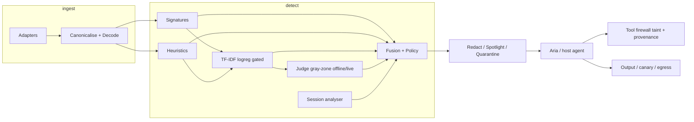

# Submission pack — PromptShield v1.0-submission

## Architecture



Adapters cover text, HTML, PDF, DOCX, email/MIME, Markdown, JSON/API, source code, image-OCR. Defence in depth: signatures + heuristics + classifier + optional judge + session risk + tool/output guards. Offsets preserved through transforms.

## Model-usage table

| Component | Model / algorithm | Why | Fallback |
|---|---|---|---|
| Signatures | YAML regex rules (294+) | Deterministic, explainable | N/A |
| Heuristics | Feature scores (+ discourse) | Cheap structure cues | N/A |
| Classifier | TF-IDF + logistic regression (`calibration.json`) | CI-friendly, no GPU | Skip layer; `degraded:["classifier"]` |
| Judge | Offline deterministic JSON; optional live LLM | Gray-zone only | Unknown → never allow alone; **not evaluated** |
| Aria | Scripted GullibleAgent | Offline demo/ASR | LLM mode if `LLM_API_KEY` (**not run**) |
| Fusion | Calibrated logistic | Combine layers | Policy thresholds |

## Demo script (~6 min)

| Time | Scene |
|---|---|
| 0:00 | Frame the problem (prompt injection → agent tools) |
| 0:30 | Arena F01 A/B (unprotected harmed / protected safe) |
| 1:30 | X-ray UV + findings (offsets, reason codes) |
| 2:15 | Encoded F09/F10 |
| 3:00 | Hard-negative F18 (security article) |
| 3:45 | Multi-turn F12 |
| 4:30 | Disable text scanning → tool deny (classic taint) |
| 5:15 | Coverage + Eval + claim ledger (D1 / F3 counts) |

Full text: `docs/DEMO_BACKUP.md`.

### Non-Docker `make demo` (README path)

From a fresh clone (uv + pnpm required; Docker optional):

```bash
make demo
# Terminal A: make _demo-api
#   or: cd apps/api && uv run uvicorn promptshield.api.app:app --reload --host 0.0.0.0 --port 8000
# Terminal B: cd apps/web && pnpm dev
# Open http://localhost:3000/arena
```

Verified against README § commands / `docs/FRESH_CLONE.md`. Compose Redis not required for this smoke path.

## Declared 3×3 position

- **F3** — **1 type supported, 7 demonstrated** (sealed-only table; tool_abuse **weak** after provenance ASR).
- **D1** — **D2 in progress** (round-4 LCI 0.819 < 0.85). **No D3.**
- **Minimal disruption** — test HN FPR 0.0 (n=62); TF legit utility 1.0; provenance security ASR regression documented (STOP).

## Claim ledger

See `docs/CLAIMS.md` and `docs/CLAIM_LEDGER.md`. Evidence: `docs/EVIDENCE.md`. Freeze hashes: `docs/FREEZE.md`. Licences: `docs/LICENCES.md`.

## Secrets scan

No real API keys or credentials in tree. Demo secrets are **canaries only** (`CANARY-*`, `fake_ssh`, reserved `*.example.test` / `*.invalid`). `LLM_API_KEY` in `.env.example` is empty.

## Freeze / tag

Tag **`v1.0-submission`**. Hashes in `docs/FREEZE.md`.
