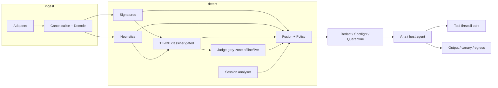

# Submission pack — PromptShield v0.1-phase5

## Architecture

## Model-usage table

| Component | Model / algorithm | Why | Fallback |
|---|---|---|---|
| Signatures | YAML regex rules (294) | Deterministic, explainable | N/A |
| Heuristics | Feature scores | Cheap structure cues | N/A |
| Classifier | TF-IDF logreg (`calibration.json`) | CI-friendly, no GPU | Skip layer; `degraded:["classifier"]` |
| Judge | Offline deterministic JSON; optional live LLM | Gray-zone only | Unknown → never allow alone |
| Aria | Scripted GullibleAgent | Offline demo/ASR | LLM mode if `LLM_API_KEY` (not measured) |
| Fusion | Calibrated logistic | Combine layers | Policy thresholds |

## Demo script (~6 min)

| Time | Scene |
|---|---|
| 0:00 | Frame the problem |
| 0:30 | Arena F01 A/B |
| 1:30 | X-ray UV + findings |
| 2:15 | Encoded F09/F10 |
| 3:00 | Hard-negative F18 |
| 3:45 | Multi-turn F12 |
| 4:30 | Disable text scanning → tool deny |
| 5:15 | Coverage + Eval + claim ledger |

Full text: `docs/DEMO_BACKUP.md`.

## Declared 3×3 position

- **F3** — detectors for all 9 types (measured per-type recall in `docs/EVIDENCE.md`).
- **D2** — claimed for **text** only (`n ≥ 10` cells). Other formats **insufficient n**.
- **Minimal disruption** — utility/FPR numbers reported; n too small for strong claims.

## Claim ledger

See `docs/CLAIMS.md` and `docs/CLAIM_LEDGER.md`. Evidence dump: `docs/EVIDENCE.md`.

## Freeze

Tag `v0.1-phase5` · hashes in `docs/FREEZE.md`.
