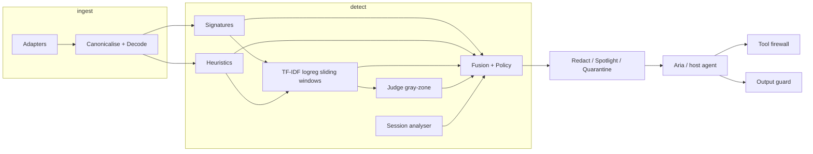

# Submission pack — PromptShield v1.3-evidence

## Architecture

## Model-usage table

| Component | Model / algorithm | Why | Fallback |
|---|---|---|---|
| Signatures | YAML regex | Deterministic | N/A |
| Heuristics | Features + discourse | Cheap cues | N/A |
| Classifier | TF-IDF logreg + windows | CI-friendly spans | `degraded:["classifier"]` |
| Judge | `LLM_MODEL_JUDGE` (Sol) / cheap tier | Gray-zone only | unknown; never allow alone; CI offline heuristic via `JUDGE_FORCE_OFFLINE` |
| Aria | Scripted GullibleAgent | Offline demo | LLM mode not evaluated |
| Fusion | Logistic + floor + clf_graded | Combine layers | Policy thresholds |

## Declared position

- **F/D on independent sealed:** **not evaluated** (external staging not arrived).
- Prior redteam-as-independent claim **withdrawn** (repo-generated → **dev_redteam**).
- Dev fit: ACTED **0.417**, FPR **0.0938** (≤2% **NOT MET**).
- Judge (dev): Sol acc **1.000**; mini **0.800**.

## Claim ledger

See `docs/CLAIMS.md`, `docs/CLAIM_LEDGER.md`, `docs/ERRATA.md`. Evidence: `docs/EVIDENCE.md`. Freeze: `docs/FREEZE.md`.

## Secrets

No API keys in git. `.env.example` has empty LLM fields. Healthz exposes `api_key_configured` boolean only.

## Tag

**`v1.3-evidence`**.
